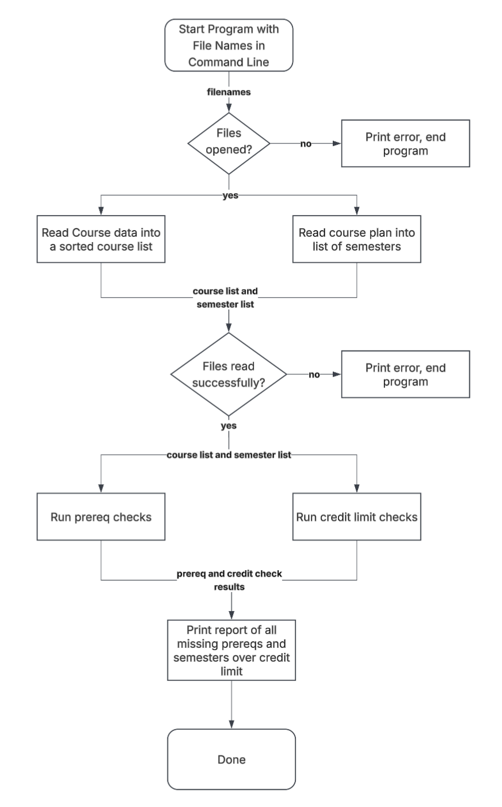

# degree-planner

I'm building a tool in C that reads a list of courses (with prereqs and credit hours) and a multi-semester plan from text files and lists all missing prereqs or semesters over credit limit.

## The Problem

Planning a multi-semester college course schedule by hand makes it easy to forget a prerequisite or overload yourself one semester. My tool will check a planned schedule against prereqs and flag credit limits.

## How It Works

The program takes two text files: a course file listing each course's credit hours and prerequisites, and a plan file listing which courses are taken in each semester. It then:

- Reads the course file into a list of courses
- Reads the plan file into a list of semesters
- Checks that every course's prerequisites are taken in an earlier semester
- Checks that no semester goes over the credit limit
- Prints a report of every problem found, or confirms the plan is valid



## Tech Stack

Language: C
Libraries: C standard library only
Data storage: txt files in plaintext for course data and semester plan
No external tools

## Setup

Requires gcc and make
```bash
git clone https://github.com/OwenSegel/degree-planner.git
cd degree-planner
make
```

## Usage

Run with a course list file and a plan file
```bash
./planner data/courses.txt data/plan.txt
```

## Roadmap

- Support for corequisites
- Detect circular prereqs in course file
- Flag courses only offered in fall/spring
- Course suggestions to fix schedule

## Author

[Owen Segel](https://github.com/OwenSegel)